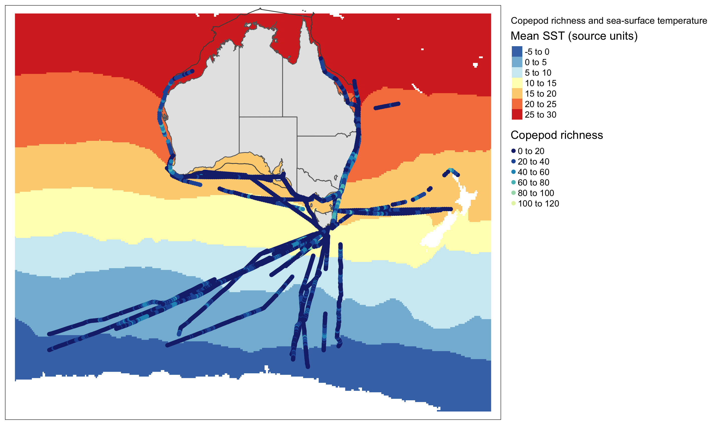

# R for Marine Science

This repository contains my work for MB5370: Techniques in Marine Science 1 at James Cook University. 
Across four workshops, I practise data management, wrangling, visualisation, reporting, and spatial analysis in R.

## Workshop work

- **Workshop 1 — Foundations of data science:** Palmer Penguins data inspection, wrangling, summary tables, and plots. The Quarto report is [`docs/workshop_01_penguins/penguin_analysis.qmd`](docs/workshop_01_penguins/penguin_analysis.qmd), with its rendered report alongside it.
- **Workshop 2 — Advanced data wrangling:** Penguin pivoting and joins, followed by the Ross River Estuary data-rescue report in [`docs/workshop_02_datarescue/workshop_02_estuary_data_rescue.qmd`](docs/workshop_02_datarescue/workshop_02_estuary_data_rescue.qmd).
- **Workshop 3 — Data communication and open-data discovery:** A reconstruction and redesign of a published Atlantic pollock figure, plus an analysis of Queensland Shark Control Program records. The QFISH report source is [`code/workshop_03_qfish_data_discovery.qmd`](code/workshop_03_qfish_data_discovery.qmd).
- **Workshop 4 — Spatial analysis:** Mapping copepod richness with spatial data in [`code/workshop_04_copepodes.Rmd`](code/workshop_04_copepodes.Rmd).

## Selected figures and maps

Copepod Richness and Sea Surface Temperature

[](https://ksturdee.github.io/R4MarineScience/outputs/workshop4/copepod-richness-interactive.html)

*Figure 1. Spatial distribution of copepod richness and mean sea surface temperature around Australia.*

**[Explore the interactive map →](https://ksturdee.github.io/R4MarineScience/outputs/workshop4/copepod-richness-interactive.html)**

## Repository structure

```text
R4MarineScience/
├── code/       # R scripts and report sources
├── data/       # Workshop source data and spatial files
├── docs/       # Quarto sources and rendered reports
├── outputs/    # Tables, figures, and interactive maps
├── index.html  # Links to rendered reports and interactive outputs
└── README.md
```

Data and outputs are grouped by workshop beneath their respective folders.

## Data sources

- **Palmer Penguins:** The Workshop 1 analyses use the `palmerpenguins` R package; a CSV copy is also stored in `data/workshop1/`.
- **Estuary exercise:** The catch log, site metadata, sensor measurements, and species dictionary in `data/workshop2/` are the course-provided Workshop 2 exercise data.
- **Workshop 3 plot deconstruction:** The local paper and supplementary workbook in `data/workshop3/fatty_acid_isotope_rawdata/` accompany Budge et al. (2023), “Fatty acid isotopic composition in Atlantic pollock is not influenced by environmentally relevant dietary fat concentrations,” *Oecologia*, 202, 513–522. [https://doi.org/10.1007/s00442-023-05403-z](https://doi.org/10.1007/s00442-023-05403-z)
- **Queensland fisheries:** `data/workshop3/CatchDataQLDGov.csv` is an export from the Queensland Fisheries QFISH Portal, specifically the Shark Control Program data. Record the export date, exact portal URL, and query filters in the report when available. These are capture records, not effort-standardised catch rates or estimates of shark abundance.
- **Workshop 4 spatial data:** The copepod tables, spatial layers, and AVHRR sea-surface-temperature raster are stored in `data/workshop4/`. Add the verified source URL, product period, units, and reuse terms to the report; these details are not fully documented in the current files.

## Reproducing the reports

Run commands from the repository root. 

```r
quarto::quarto_render("docs/workshop_01_penguins/penguin_analysis.qmd")
quarto::quarto_render("docs/workshop_02_datarescue/workshop_02_estuary_data_rescue.qmd")
quarto::quarto_render("docs/workshop_03_PlotDeconstruction/workshop_03_PlotDeconstruction.qmd")

source("code/workshop_03_QLDGovExploration.R")
quarto::quarto_render(
  "code/workshop_03_qfish_data_discovery.qmd",
  output_dir = "docs/workshop_03_QLDdataDiscovery"
)

dir.create("docs/workshop_04_spatial", recursive = TRUE, showWarnings = FALSE)
rmarkdown::render(
  "code/workshop_04_copepodes.Rmd",
  output_file = "workshop_04_copepodes.html",
  output_dir = "docs/workshop_04_spatial"
)
```

The numbered workshop scripts and reports use project-relative paths.